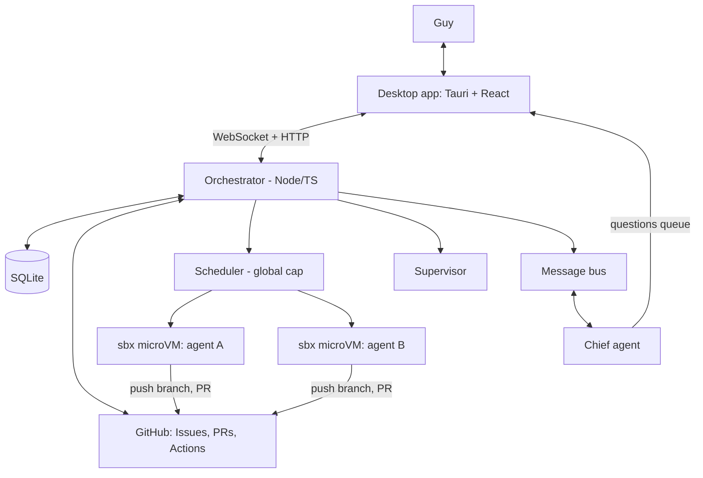
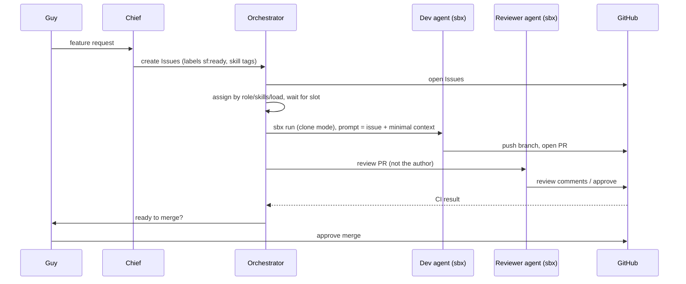
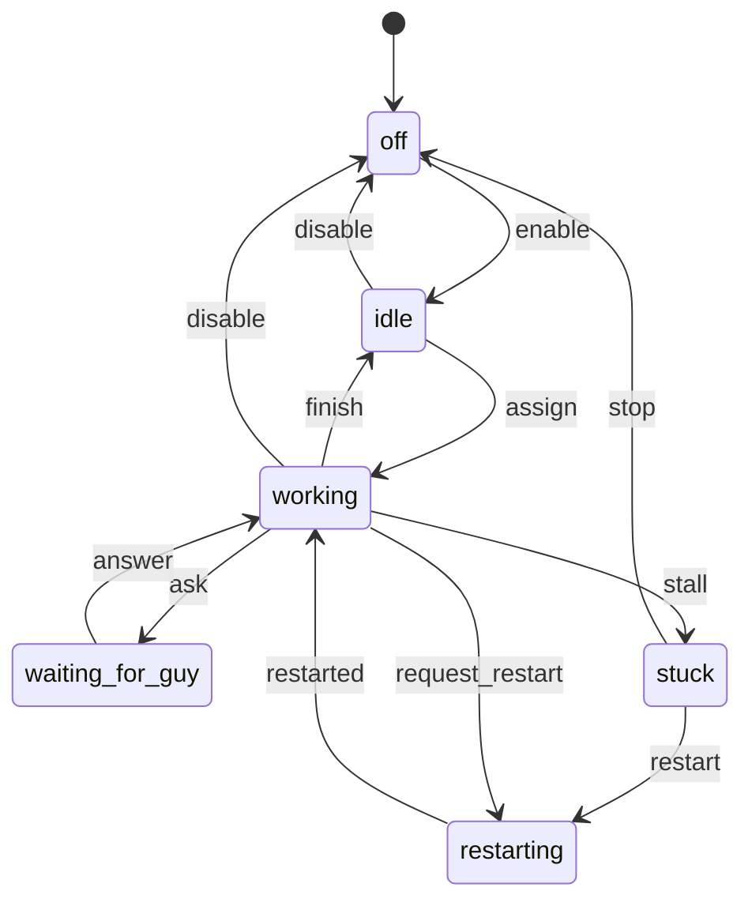

# Software Factory – Design

## 1. Vision
A local, free "software factory": Guy links GitHub projects, describes work to a Chief agent, and a configurable team of AI agents implements, reviews and secures it, each in an isolated Docker Sandbox on his own machine. GitHub is the source of truth (GitOps). Guy approves merges.

## 2. Requirements
- Fully local, no cloud services. Costs are only model subscriptions/API.
- Isolation: Docker Sandboxes (`sbx`), one microVM per agent, clone mode.
- GitHub: projects = existing or new repos; tasks = Issues + labels; work = branch + PR; CI = Actions; merge only after Guy approves.
- Dynamic team: unlimited agents, each a profile (see §5). Templates and clone-agent.
- Chief = agent with chief role; only one talking to Guy; splits requests into Issues, assigns by role/skills/load; can pause a task and ask Guy (questions queue + desktop notification).
- Agents talk only through the orchestrator message bus (logged, visible).
- Cross review: every PR reviewed by a review-role agent, never the author. Security review runs ESLint, Semgrep, gitleaks, npm audit first; the LLM sees only findings + diff.
- Global concurrency cap (default 3), others queue.
- Lifecycle: per-agent on/off, stop-all, modes quiet/eco/full, manual restart preserving progress, supervisor (heartbeat, stuck, loop/token-burn), escalation soft-stop -> restart -> stop + notify, self-restart of dev servers, `request_restart` tool, max restarts per task.
- Token saving: model per role, minimal per-task context, budgets with auto-stop.
- Stack: Tauri + React + shadcn; Node + TypeScript orchestrator; SQLite + Drizzle; WebSocket; pnpm monorepo.

## 3. Architecture



Processes: the orchestrator is a standalone Node process (Tauri sidecar). The UI never touches the DB or sbx directly. Only the orchestrator writes SQLite.

### Task flow


### Agent state machine

Implemented in `packages/orchestrator/src/state-machine.ts`.

## 4. Data model (SQLite, Drizzle: `packages/db/src/schema.ts`)
- `projects`: id, name, repo (owner/name), default_branch
- `agents`: profile fields (§5), enabled, state
- `tasks`: project, issue_number, title, status, assignee, branch, pr_number, summary (checkpoint), restart_count
- `runs`: task, agent, sandbox_name, started/ended, exit_reason, last_heartbeat_at
- `messages`: task, from/to agent (null = Guy), body (the bus log)
- `questions`: task, agent, body, answer, asked/answered
- `costs`: run, agent, input/output tokens, usd

## 5. Agent profile
name, role, description (system prompt), provider (`claude-code|codex|cursor`), model, effort, context (instruction files such as AGENTS.md/CLAUDE.md, allowed paths, history size), permissions (`advise|open_pr|review|merge`), daily token budget, max runtime, sandbox CPU/RAM, skill tags. Templates are stored profiles; clone-agent copies a row.

## 6. Provider adapter interface (`packages/adapters`)
```ts
interface ProviderAdapter {
  id: "claude-code" | "codex" | "cursor";
  executables: string[];                 // claude | codex | cursor-agent, agent
  sbxAgent: string;                      // agent name for `sbx create`
  buildCommand(spec: AgentRunSpec): { argv: string[]; stdin?: string; files?: Record<string,string> };
  parseLine(line: string): AgentEvent[]; // text | tool_call | usage | cost | done
}
```
The prompt goes through stdin where the CLI supports it (no shell quoting or argv length issues on Windows).

| Provider | Command built | Flags verified in official docs | Still unverified |
|---|---|---|---|
| Claude Code | `claude -p --output-format stream-json --verbose --model M --effort E --append-system-prompt S --mcp-config F --settings F --max-turns N --permission-mode bypassPermissions` (sandboxed) / `acceptEdits --allowedTools ...` (host) / `--allowedTools "mcp__factory Read Glob Grep"` (read-only) | all flags (docs.claude.com CLI reference) | exact `stream-json` event shapes on a live run; `--effort` accepted values per model |
| Codex | `codex exec --json --skip-git-repo-check -m M -s <sandbox> -c model_reasoning_effort="E" -C DIR [-c mcp_servers.factory.url="..."] -` | `exec`, `--json`, `-m`, `-s`, `-c`, `-C`, `--skip-git-repo-check` (developers.openai.com/codex/cli/reference) | JSONL event schema; `mcp_servers.<name>.url` config key; `-` for stdin |
| Cursor Agent | `cursor-agent -p --output-format stream-json --trust --approve-mcps --model M --workspace DIR (--force \| --mode ask) PROMPT`; MCP via `.cursor/mcp.json` | `-p`, `--output-format`, `--force`, `--trust`, `--approve-mcps`, `--model`, `--workspace`, `--mode ask` (cursor.com/docs/cli/reference/parameters) | event schema; binary name (`cursor-agent` vs `agent`: both are tried); usage reporting |

## 7. Sandbox integration (`sbx`)
Wrapped in `workspace.ts` behind a `Workspace` interface with two implementations (sbx and host git worktree). Commands used (verified in docs.docker.com/ai/sandboxes/usage):
```
sbx policy init balanced                     # once; Setup tab button also allows github.com, api.anthropic.com, api.openai.com, api2.cursor.sh, registry.npmjs.org
sbx secret set github --command 'gh auth token'   # once, by Guy
sbx create --clone --name sf-<task8> <agent> <host-base-clone>   # private in-sandbox clone
sbx exec [-e K=V ...] sf-<task8> <cmd...>    # run the provider CLI / git inside (foreground)
sbx stop sf-<task8>; sbx rm --force sf-<task8>
```
Flow per task: host base clone is refreshed, `sbx create --clone`, `origin` is pointed at GitHub, task branch checked out, files (hook script, MCP config, skills) written with `sbx exec ... base64 -d`, provider CLI runs through `sbx exec`, then the orchestrator runs `git push` inside the sandbox and opens the PR through the GitHub API on the host.

**Unverified (needs a real sbx install):** whether the in-sandbox working directory equals the `sbx exec` default cwd (assumed), CPU/RAM flags (agent `cpu`/`ram_mb` are stored but not yet passed to sbx), whether `host.docker.internal` reaches the orchestrator from the microVM (configurable in Settings), whether `sbx secret set github` makes `git push` work inside the sandbox, and the exact agent names accepted by `sbx create` for Codex and Cursor.

## 8. GitOps flow
- Labels: `sf:ready` (to be picked up), `sf:working`, `sf:review`, `sf:blocked` (waiting for Guy), plus skill tags.
- Branch `sf/<issue>-<slug>`; PR links `Closes #N`; a PR template is included.
- Orchestrator polls GitHub (webhooks need a public endpoint, so polling by default, ETag-conditional).
- CI = Actions. Main is branch-protected: PR + green CI + Guy's approval required. Agents lack merge permission unless the profile grants it and Guy enables it per project.

## 9. Supervisor and restart design
- Heartbeat: adapter events and a sandbox ping every ~10 s update `runs.last_heartbeat_at`.
- Stuck: no heartbeat or no progress (no new commits/tool calls/tokens of value) for N minutes (default 10).
- Loop/token-burn: same tool call repeated K times or tokens spent without diff change -> flag.
- Escalation: soft-stop (ask agent to checkpoint) -> restart sandbox -> stop + desktop notification. Retries are capped by `max_restarts_per_task` (default 3).
- Checkpoint: before any restart the orchestrator pushes the WIP branch and stores a task summary in `tasks.summary`; the restarted agent gets summary + branch.
- Self restart: inside the sandbox, agents restart dev servers/containers freely. Full sandbox restart via the `request_restart(reason)` tool.
- Modes: quiet (no agents), eco (1 running), full (up to cap). Stop-all pauses everything; resume continues from checkpoints.

## 10. Security model
- Agents only run inside sandboxes; no host mounts except the repo clone.
- Secrets via `sbx secret`; never in files, prompts or logs. Logs are scrubbed.
- Network allowlist only. Fine-grained GitHub token per project.
- Least privilege per agent permissions. Merge only by Guy.
- Security review: ESLint, Semgrep, gitleaks, `npm audit` run first; LLM receives findings + diff only.
- Treat Issue/PR text as untrusted input (prompt injection): agents cannot change permissions or network policy.

## 11. Token-saving strategy
Strong model for Chief (few turns), mid model for developers, cheap/low-effort for review. Tools before LLM. Per-task context: issue, relevant files, short summary, never the full chat. Daily budget per agent with auto-stop; costs table feeds the dashboard.

## 12. Dashboard screens
Kanban (queued / working / waiting for Guy / in review / done); agent cards (state, current task, tokens, on/off, restart, edit); agent settings form; logs per run; Chief chat with the questions queue; costs; global controls (stop-all, mode, cap). Style: clean, light, work-method look, subtle cute touches (avatars/status dots), not cartoonish.

## 13. Roadmap and acceptance criteria
1. **Phase 1 – Orchestrator + one dev agent**: Issue labelled `sf:ready` -> sandbox -> branch -> PR. AC: on Guy's machine one labelled Issue produces a PR with CI running; run, cost and state persisted in SQLite; sandbox removed afterward.
2. **Phase 2 – Chief + questions queue**: AC: Guy chats with Chief; Chief creates Issues; an agent question pauses the task and shows a desktop notification; the answer resumes it.
3. **Phase 3 – More agents + cross review**: AC: N agents defined; concurrency cap honoured; every PR reviewed by a non-author reviewer; security tools run first; findings posted.
4. **Phase 4 – Dashboard + settings**: AC: Tauri app shows live kanban, agent cards, logs, chat, costs; on/off, restart, modes and agent settings work.
5. **Supervisor hardening** (spans phases 1-4): heartbeat, stuck/loop detection, escalation, `request_restart`.

## 14. Open questions
- Exact `sbx` flags for clone mode, network policy and resources in the installed version.
- Whether `cursor-agent` and `codex exec` stream JSON usable for token accounting.
- Polling vs. a tunnel for webhooks.
- Auth for subscriptions inside sandboxes (login persisted vs. API keys).
- Machine size: how many concurrent sandboxes Guy's machine handles.

## 15. Implementation status (v0.1.0)
Working end to end (verified with a scripted fake provider CLI against real GitHub: Issue -> branch -> PR -> reviewer comment -> ready to merge): task intake from `status:ready` Issues, assignment, git-worktree runner, MCP factory tools (progress, task context), hooks endpoint, supervisor, scanners (skipped when tools are missing), reviewer flow, dashboard, settings, health checks.

Written but not exercised against the real thing: sbx runner, real Claude/Codex/Cursor event streams, Chief chat and `ask_guy` pause/resume with a real model, desktop notifications, OS keychain on each OS, installers launching on Windows/macOS.

Deviations from the original design: `node:sqlite` instead of Drizzle (ADR 4); orchestrator is a bundled Node sidecar (ADR 5); the Chief runs read-only on the host (it never edits code) and is exempt from the concurrency cap so chat stays responsive; "worktree" fallback uses git worktrees off a per-project base clone.

### Phase 2 progress (see docs/PHASE2.md)
- **M0 Foundations (done):** versioned SQLite migrations (`schema_migrations`, v1 = the v0.1.0 schema, each step in a transaction, refuses a database from a newer app); v2 project kinds (`github` | `folder` | `none`, `root_path`, nullable `repo`); v3 unified tasks (`source`, `type`, `external_ref`, `md_path`, `priority`, `due_at`, `parent_id`, `automation_id`, nullable `project_id`). `issue_number` and `kind` remain as generated columns so older queries and the UI keep working. Agents only pick up `code`/`review` tasks on `github` projects. A v0.1.0 database is migrated in place (CI seeds one and starts the app on Windows, macOS and Linux).
- **M1 IDE browse and diff:** see the M1 entry below once merged.

### Efficiency layer
- **MCP:** every agent gets the local `factory` server. GitHub and filesystem MCP are opt-in per agent because tool definitions are re-sent on every request and cost tokens.
- **Skills:** `skills/*/SKILL.md` are copied into each workspace (`.claude/skills` for Claude Code, `.sf/skills` for others). Chief gets all; workers get role defaults plus their own tags.
- **Hooks:** Claude Code `PreToolUse` blocks dangerous commands/paths (`guard.ts`), `PostToolUse`/`Stop` are heartbeats; git `pre-push` blocks main/master, `post-commit` heartbeats. Codex and Cursor rely on sandbox isolation + git hooks (no equivalent hook API used).
- **Token saving:** model and effort per role (Chief strong but short-lived, Dev medium, Reviewer cheap), reviewers see only scanner findings + diff, per-agent daily budgets with auto-stop, `--max-turns` for chat/review, small stable system prompt first and task text last so provider prompt caching can reuse the prefix.
