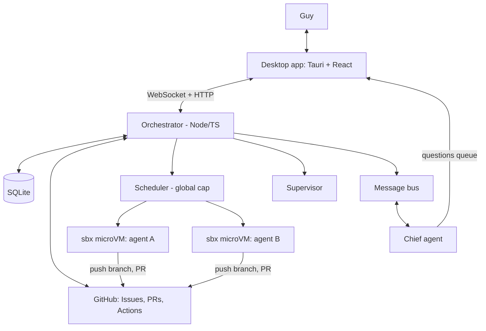
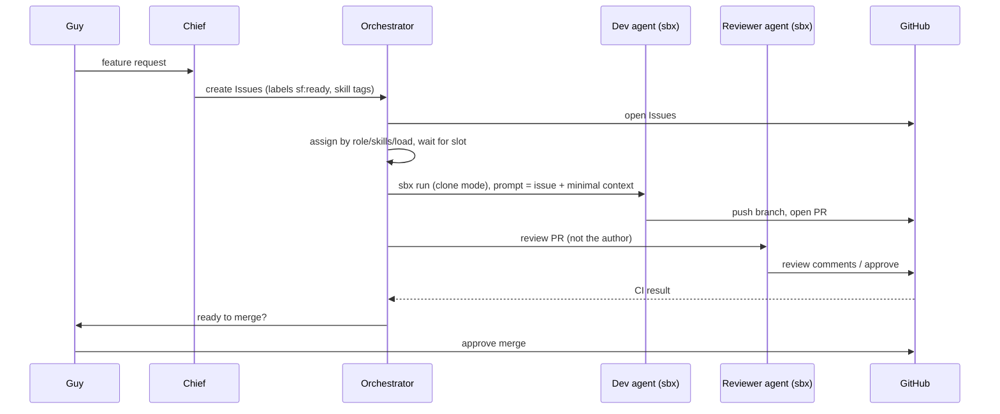
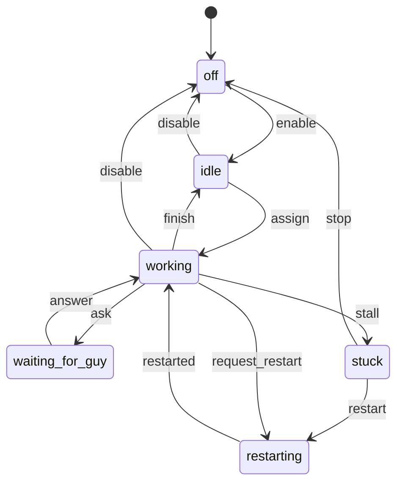

# Software Factory – Design

## 1. Vision
A local, free "software factory": Guy links GitHub projects, describes work to a Chief agent, and a configurable team of AI agents implements, reviews and secures it, each in an isolated Docker Sandbox on his own machine. GitHub is the source of truth (GitOps). Guy approves merges.

## 2. Requirements
- Fully local, no cloud services. Costs are only model subscriptions/API.
- Isolation: Docker Sandboxes (`sbx`), one microVM per agent, clone mode.
- GitHub: projects = existing or new repos; tasks = Issues + labels; work = branch + PR; CI = Actions; merge only after Guy approves.
- Dynamic team: unlimited agents, each a profile (see §5). Templates and clone-agent.
- Chief = agent with chief role; only one talking to Guy; splits requests into Issues, assigns by role/skills/load; can pause a task and ask Guy (questions queue + desktop notification).
- Agents talk only through the orchestrator message bus (logged, visible).
- Cross review: every PR reviewed by a review-role agent, never the author. Security review runs ESLint, Semgrep, gitleaks, npm audit first; the LLM sees only findings + diff.
- Global concurrency cap (default 3), others queue.
- Lifecycle: per-agent on/off, stop-all, modes quiet/eco/full, manual restart preserving progress, supervisor (heartbeat, stuck, loop/token-burn), escalation soft-stop -> restart -> stop + notify, self-restart of dev servers, `request_restart` tool, max restarts per task.
- Token saving: model per role, minimal per-task context, budgets with auto-stop.
- Stack: Tauri + React + shadcn; Node + TypeScript orchestrator; SQLite + Drizzle; WebSocket; pnpm monorepo.

## 3. Architecture



Processes: the orchestrator is a standalone Node process (Tauri sidecar). The UI never touches the DB or sbx directly. Only the orchestrator writes SQLite.

### Task flow


### Agent state machine

Implemented in `packages/orchestrator/src/state-machine.ts`.

## 4. Data model (SQLite, Drizzle: `packages/db/src/schema.ts`)
- `projects`: id, name, repo (owner/name), default_branch
- `agents`: profile fields (§5), enabled, state
- `tasks`: project, issue_number, title, status, assignee, branch, pr_number, summary (checkpoint), restart_count
- `runs`: task, agent, sandbox_name, started/ended, exit_reason, last_heartbeat_at
- `messages`: task, from/to agent (null = Guy), body (the bus log)
- `questions`: task, agent, body, answer, asked/answered
- `costs`: run, agent, input/output tokens, usd

## 5. Agent profile
name, role, description (system prompt), provider (`claude-code|codex|cursor`), model, effort, context (instruction files such as AGENTS.md/CLAUDE.md, allowed paths, history size), permissions (`advise|open_pr|review|merge`), daily token budget, max runtime, sandbox CPU/RAM, skill tags. Templates are stored profiles; clone-agent copies a row.

## 6. Provider adapter interface (`packages/adapters`)
```ts
interface ProviderAdapter {
  id: "claude-code" | "codex" | "cursor";
  buildCommand(spec: AgentRunSpec): string[];   // non-interactive, JSON output
  parseLine(line: string): AgentEvent[];        // text | tool_call | usage | request_restart | ask_guy | done
}
```
Commands: `claude -p "<prompt>" --output-format stream-json --verbose --model <m>`; `codex exec --json "<prompt>"`; `cursor-agent -p "<prompt>" --output-format stream-json`. Verify flags against installed versions in phase 1. `ask_guy` and `request_restart` reach the orchestrator through small tools exposed to the agent (an MCP server or CLI shim in the sandbox) that write to the orchestrator.

## 7. Sandbox integration (`sbx`)
Wrapped by a `SandboxDriver` interface. Exact flow (verify flags against `sbx --help` for the installed version):
```
sbx login
sbx secret set github                       # token stays outside agent
sbx run claude --name sf-<agent>-<task> <repo-path-or-clone>   # clone mode: private repo clone per agent
sbx ls
sbx stop sf-<agent>-<task>
sbx rm sf-<agent>-<task>
```
Network policy: deny by default; allow `github.com`, `api.github.com`, and the provider host (`api.anthropic.com`, `api.openai.com`, Cursor API). CPU/RAM from agent profile. Agents may start their own dev servers and containers using the sandbox's private Docker engine, which cannot touch the host.

## 8. GitOps flow
- Labels: `sf:ready` (to be picked up), `sf:working`, `sf:review`, `sf:blocked` (waiting for Guy), plus skill tags.
- Branch `sf/<issue>-<slug>`; PR links `Closes #N`; a PR template is included.
- Orchestrator polls GitHub (webhooks need a public endpoint, so polling by default, ETag-conditional).
- CI = Actions. Main is branch-protected: PR + green CI + Guy's approval required. Agents lack merge permission unless the profile grants it and Guy enables it per project.

## 9. Supervisor and restart design
- Heartbeat: adapter events and a sandbox ping every ~10 s update `runs.last_heartbeat_at`.
- Stuck: no heartbeat or no progress (no new commits/tool calls/tokens of value) for N minutes (default 10).
- Loop/token-burn: same tool call repeated K times or tokens spent without diff change -> flag.
- Escalation: soft-stop (ask agent to checkpoint) -> restart sandbox -> stop + desktop notification. Retries are capped by `max_restarts_per_task` (default 3).
- Checkpoint: before any restart the orchestrator pushes the WIP branch and stores a task summary in `tasks.summary`; the restarted agent gets summary + branch.
- Self restart: inside the sandbox, agents restart dev servers/containers freely. Full sandbox restart via the `request_restart(reason)` tool.
- Modes: quiet (no agents), eco (1 running), full (up to cap). Stop-all pauses everything; resume continues from checkpoints.

## 10. Security model
- Agents only run inside sandboxes; no host mounts except the repo clone.
- Secrets via `sbx secret`; never in files, prompts or logs. Logs are scrubbed.
- Network allowlist only. Fine-grained GitHub token per project.
- Least privilege per agent permissions. Merge only by Guy.
- Security review: ESLint, Semgrep, gitleaks, `npm audit` run first; LLM receives findings + diff only.
- Treat Issue/PR text as untrusted input (prompt injection): agents cannot change permissions or network policy.

## 11. Token-saving strategy
Strong model for Chief (few turns), mid model for developers, cheap/low-effort for review. Tools before LLM. Per-task context: issue, relevant files, short summary, never the full chat. Daily budget per agent with auto-stop; costs table feeds the dashboard.

## 12. Dashboard screens
Kanban (queued / working / waiting for Guy / in review / done); agent cards (state, current task, tokens, on/off, restart, edit); agent settings form; logs per run; Chief chat with the questions queue; costs; global controls (stop-all, mode, cap). Style: clean, light, work-method look, subtle cute touches (avatars/status dots), not cartoonish.

## 13. Roadmap and acceptance criteria
1. **Phase 1 – Orchestrator + one dev agent**: Issue labelled `sf:ready` -> sandbox -> branch -> PR. AC: on Guy's machine one labelled Issue produces a PR with CI running; run, cost and state persisted in SQLite; sandbox removed afterward.
2. **Phase 2 – Chief + questions queue**: AC: Guy chats with Chief; Chief creates Issues; an agent question pauses the task and shows a desktop notification; the answer resumes it.
3. **Phase 3 – More agents + cross review**: AC: N agents defined; concurrency cap honoured; every PR reviewed by a non-author reviewer; security tools run first; findings posted.
4. **Phase 4 – Dashboard + settings**: AC: Tauri app shows live kanban, agent cards, logs, chat, costs; on/off, restart, modes and agent settings work.
5. **Supervisor hardening** (spans phases 1-4): heartbeat, stuck/loop detection, escalation, `request_restart`.

## 14. Open questions
- Exact `sbx` flags for clone mode, network policy and resources in the installed version.
- Whether `cursor-agent` and `codex exec` stream JSON usable for token accounting.
- Polling vs. a tunnel for webhooks.
- Auth for subscriptions inside sandboxes (login persisted vs. API keys).
- Machine size: how many concurrent sandboxes Guy's machine handles.
